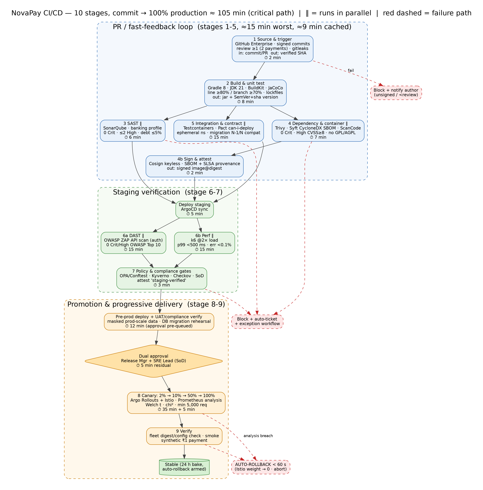
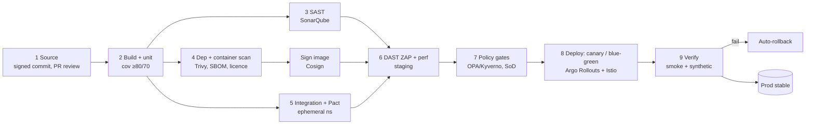

# DEVOPS & CLOUD ENGINEER - ZERO-DOWNTIME CI/CD PIPELINE WITH COMPLIANCE GATES FOR BANKING APPLICATIONS

> *Case study: NovaPay Digital Bank (fictional, RBI-licensed).*

> **AI Attribution:** Drafted with Claude (Anthropic) on 23 Oct 2026 as an AI-accelerated first draft. Reviewed, edited, validated (linters, unit tests, source checks) and approved by **Mohammad Sinan Ali**.

**Track:** DevOps & Cloud Engineer · **Author:** Mohammad Sinan Ali · **Simulation:** PIPELINE FORGE ("Deploy Fast. Stay Compliant. Never Go Down.")

## Executive summary
NovaPay deploys fortnightly by manual SSH, recovers from incidents in 4.5 h, has no automated compliance scanning and 17 open RBI non-conformances. This repository replaces that with a **10-stage, GitOps-driven pipeline** (8 canonical stages + SBOM/signing and post-deploy verification as explicit stages): signed commits → build → SAST → dependency/container scan → integration & contract tests → DAST → policy & compliance gates → progressive deployment with automated verification. Every gate is a **blocking** control mapped to RBI / PCI-DSS v4.0 and emits an immutable JSON audit record. Blue-green and canary (Istio + Argo Rollouts) use Prometheus-driven analysis with three rollback tiers (<60 s auto, <15 min escalated, manual). Database changes follow expand → migrate → contract, validated for 100M-row tables. Standard-risk changes reach 100% production in **≈100 min** (budgeted) with a design target of **99.999%** availability.

## Table of contents
| # | Deliverable | Link |
|---|---|---|
| 1 | Pipeline architecture (10 stages, timings, parallelism) | [docs/01](docs/01-pipeline-architecture/architecture.md) · [stage specs ×10](docs/01-pipeline-architecture/stage-details/README.md) · [diagrams ×8](docs/01-pipeline-architecture/diagrams/) |
| 2 | Blue-green + canary + Knight Capital verification | [docs/02](docs/02-deployment-strategies/deployment-strategies.md) · [verification](docs/02-deployment-strategies/knight-capital-verification.md) |
| 3 | 8 compliance gates, RBI / PCI mapping, audit schema | [docs/03](docs/03-compliance-gates/compliance-gates.md) |
| 4 | Zero-downtime DB migration + compatibility matrix | [docs/04](docs/04-database-migration/database-migration.md) |
| 5 | Environment promotion, config, blackout calendar | [docs/05](docs/05-environment-promotion/environment-promotion.md) · [blackout](docs/05-environment-promotion/blackout-calendar.md) |
| 6 | Automated rollback spec + Cloudflare-style config pipeline | [docs/06](docs/06-rollback-specification/rollback-specification.md) · [config pipeline](docs/06-rollback-specification/config-change-pipeline.md) |
| 7 | Runbook, incident playbook, Friday-5PM simulation | [runbooks/](runbooks/) · [docs/07](docs/07-runbook-playbook/incident-simulation.md) |
| 8 | DORA + 18 metrics, 3 dashboards, alerting, YES-Bank stack, **Sandbox: ML pipeline intelligence** | [docs/08](docs/08-observability/observability.md) · [sandbox](docs/08-observability/sandbox-extensions.md) |
| – | Research notes (≥3 sources per deliverable) | [docs/research-notes.md](docs/research-notes.md) |
| – | Errata (3 deliberate errors) | [ERRATA.md](ERRATA.md) |
| – | Self-assessment, reflections, TRC deck (20 slides), test results | [evidence/](evidence/) |

## Architecture overview

Quick view (Mermaid):

## Repository navigation
`docs/` deliverables · `pipeline/` workflows, Helm, Terraform, OPA/Kyverno, scripts · `dashboards/` Grafana JSON + wireframes · `runbooks/` ops docs · `evidence/` self-assessment, reflections, screenshots, TRC deck.

> **Note on layout:** the brief mandates workflows under `pipeline/.github/workflows/`. GitHub only executes workflows from the repository-root `.github/workflows/`; to run them for real, copy (or symlink) them there.

## Tools used
GitHub Actions, SonarQube, Trivy, Syft, Cosign, OWASP ZAP, Pact, OPA/Conftest, Kyverno, Checkov, Terraform, Helm, ArgoCD, Argo Rollouts, Istio, Prometheus, Alertmanager, Grafana, Loki, OpenTelemetry, pgroll, Vault, Claude (AI drafting).

## Validation (evidence in [evidence/test-results](evidence/test-results/))
`bash pipeline/scripts/validate.sh` runs yamllint, JSON checks, ShellCheck, `opa check` + **13 Rego unit tests**, `promtool` rule checks + **9 alert unit tests**, **15 pytest tests** (canary statistics, Knight-Capital fleet guard, ML sandbox), Terraform formatting and — where Helm is installed — `helm lint` and Conftest on the rendered chart. Missing tools are reported as SKIP, never as PASS.

## Honest limits
No live-cluster run yet (lab plan: [D2 §6](docs/02-deployment-strategies/deployment-strategies.md)); Helm lint/Terraform validate need to be run locally; ML sandbox uses synthetic data; RBI paragraph numbers to be confirmed against the Master Direction. Details: [self-assessment](evidence/self-assessment.md).

## How this was built
AI-accelerated (Claude, Anthropic) as the brief allows; every deliverable carries an AI Attribution block, and everything executable was executed and tested. Errors in the brief — and in AI output — are recorded in [ERRATA.md](ERRATA.md).
