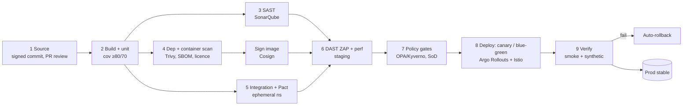

# DEVOPS & CLOUD ENGINEER - ZERO-DOWNTIME CI/CD PIPELINE WITH COMPLIANCE GATES FOR BANKING APPLICATIONS

> *Case study: NovaPay Digital Bank (fictional, RBI-licensed).*

> **AI Attribution:** AI-assisted (Claude, Anthropic); reviewed and validated by Mohammad Sinan Ali.

**Track:** DevOps & Cloud Engineer · **Author:** Mohammad Sinan Ali · **Simulation:** PIPELINE FORGE ("Deploy Fast. Stay Compliant. Never Go Down.")

## Executive summary
NovaPay deploys fortnightly by manual SSH, recovers from incidents in 4.5 h, has no automated compliance scanning and 17 open RBI non-conformances. This repository replaces that with a **10-stage, GitOps-driven pipeline** (8 canonical stages + SBOM/signing and post-deploy verification as explicit stages): signed commits → build → SAST → dependency/container scan → integration & contract tests → DAST → policy & compliance gates → progressive deployment with automated verification. Every gate is a **blocking** control mapped to RBI / PCI-DSS v4.0 and emits an immutable JSON audit record. Blue-green and canary (Istio + Argo Rollouts) use Prometheus-driven analysis with three rollback tiers (<60 s auto, <15 min escalated, manual). Database changes follow expand → migrate → contract, validated for 100M-row tables. Standard-risk changes reach 100% production in **≈105 min** (budgeted) with a design target of **99.999%** availability.

## Table of contents
| # | Deliverable | Link |
|---|---|---|
| 1 | Pipeline architecture (10 stages, timings, parallelism) | [docs/01](docs/01-pipeline-architecture/architecture.md) · [stage specs ×10](docs/01-pipeline-architecture/stage-details/README.md) · [diagrams ×8](docs/01-pipeline-architecture/diagrams/) |
| 2 | Blue-green + canary + Knight Capital verification | [docs/02](docs/02-deployment-strategies/deployment-strategies.md) · [verification](docs/02-deployment-strategies/knight-capital-verification.md) |
| 3 | 8 compliance gates, RBI / PCI mapping, audit schema | [docs/03](docs/03-compliance-gates/compliance-gates.md) |
| 4 | Zero-downtime DB migration + compatibility matrix | [docs/04](docs/04-database-migration/database-migration.md) |
| 5 | Environment promotion, config, blackout calendar | [docs/05](docs/05-environment-promotion/environment-promotion.md) · [blackout](docs/05-environment-promotion/blackout-calendar.md) |
| 6 | Automated rollback spec + Cloudflare-style config pipeline | [docs/06](docs/06-rollback-specification/rollback-specification.md) · [config pipeline](docs/06-rollback-specification/config-change-pipeline.md) |
| 7 | Runbook, incident playbook, Friday-5PM simulation | [runbooks/](runbooks/) · [docs/07](docs/07-runbook-playbook/incident-simulation.md) |
| 8 | DORA + 18 metrics, 3 dashboards, alerting, YES-Bank stack, **Sandbox: ML pipeline intelligence** | [docs/08](docs/08-observability/observability.md) · [sandbox](docs/08-observability/sandbox-extensions.md) |
| – | Research notes (≥3 sources per deliverable) | [docs/research-notes.md](docs/research-notes.md) |
| – | Errata (3 deliberate errors) | [ERRATA.md](ERRATA.md) |
| – | Self-assessment, reflections, TRC deck (20 slides), test results | [evidence/](evidence/) |

## Architecture overview


Quick view (Mermaid):


## What this project is (in plain words)
A bank cannot simply "deploy fast": every change must be tested, scanned, approved by the right people and provable to an auditor, and it must never take payments offline. This repository is a **complete design and working toolkit** for doing both at once for a fictional bank, NovaPay:

- **Design documents (8 deliverables)** — the architecture, the rules, the numbers and the reasoning, written so a technology risk committee can approve it.
- **Working code and config** — GitHub Actions workflows, Kubernetes/Helm/Argo manifests, Terraform, policy-as-code (Rego/Kyverno), Prometheus alert rules, Grafana dashboards and helper scripts.
- **Evidence** — unit tests that actually run (policies, alerts, canary maths, fleet guard), a simulated incident with a timeline, a post-mortem, and a 20-slide committee presentation.

## How it works — the life of one code change
Follow a single change from a developer's laptop to customers. Anything marked **BLOCK** stops the change; nothing is skippable, including hotfixes.

1. **Commit & pull request (stage 1).** The developer opens a PR from a short-lived branch. Commits must be *signed*; the PR needs reviewers (two for payment code, a DBA for database code); secrets are scanned. Direct pushes to `main` and admin bypass are not allowed. **BLOCK** if unsigned, unreviewed or a secret is found.
2. **Build & unit test (stage 2).** Gradle/JDK 21 builds the service in a container; unit tests must pass with ≥80% line and ≥70% branch coverage. The artefact gets a version like `1.14.2+<git-sha>.<time>.run<id>` — never `latest`.
3. **Three checks run at the same time (stages 3–5), so feedback arrives in ~10–15 minutes:**
   - **SAST** (SonarQube): no Critical issues, at most 2 High, technical-debt limits.
   - **Dependency & container scan** (Trivy + licence check + SBOM): no Critical CVEs, no GPL/AGPL; an SBOM (list of every component) is produced.
   - **Integration & contract tests** (Testcontainers, Pact): services still understand each other, and the new database migration works with *both* the old and the new app version.
4. **Sign (stage 4b).** The image is signed with Cosign and carries its SBOM and build provenance, so the cluster can later prove *who built it and from what*.
5. **Deploy to staging, then DAST + performance (stage 6, in parallel).** OWASP ZAP attacks the running API (0 Critical/High allowed); k6 load-tests it at 2× expected traffic (p99 <500 ms). If both pass, a second signed statement — a **"staging-verified" attestation** — is attached to this exact image.
6. **Policy & compliance gates (stage 7).** OPA/Conftest, Kyverno and Checkov check the Kubernetes manifests and infrastructure code (no privileged containers, limits set, TLS 1.3, no plaintext secrets, images pinned by digest), and a **segregation-of-duties** check enforces that author ≠ approver ≠ deployer. Every gate writes a tamper-evident JSON audit record.
7. **Pre-production and approval.** The same image is promoted with different configuration. UAT and compliance checks run; the **Release Manager and SRE Lead both approve** (pre-queued so they don't add waiting time). The blackout calendar blocks deployments near salary days, festivals, month-end and RBI settlement windows.
8. **Progressive deployment (stage 8).** Argo Rollouts and Istio send 2% → 10% → 50% → 100% of traffic to the new version (a longer 24-hour-bake profile exists for high-risk changes). At each step Prometheus data is compared with the old version using statistics (Welch t-test for latency, chi-squared for error rates). Good → promote; borderline → wait; bad → roll back.
9. **Verification (stage 9).** Scripts confirm *every* pod runs the same image digest and configuration (the Knight Capital guard), smoke tests run, and a synthetic ₹1 payment goes through.
10. **If anything goes wrong in production.** Alerts are sorted into three categories: **A** (e.g. 5xx >5%, crash loops, DB pool exhaustion) → automatic rollback in under 60 seconds; **B** (e.g. p99 latency double, success rate drops) → page on-call, auto-rollback after 15 minutes; **C** (slow burns, customer reports) → human decision. Then the incident playbook, communications and post-mortem take over.

**Hotfixes use the same path, only faster.** Even an "emergency" image is rejected by the cluster if it lacks a valid signature *and* the staging-verified attestation — so a hotfix cannot silently skip staging (this is what failed in the Friday 5 PM simulation).

## How the key mechanisms work
| Mechanism | How it works | Where to read |
|---|---|---|
| **Compliance gates** | 8 blocking checks, each with numeric thresholds, fix guidance, a time-limited exception route (auto-expiring) and a JSON audit record that is hash-chained and stored in write-once storage | [D3](docs/03-compliance-gates/compliance-gates.md) · `pipeline/policies/` |
| **Supply-chain trust** | Images are signed by digest; SBOM + provenance attached; Kyverno only admits images with valid signature + staging attestation; GitHub Actions are pinned to commit SHAs | [stage 4b](docs/01-pipeline-architecture/stage-details/04b-sign-attest.md) · `pipeline/policies/verify-images.yaml` |
| **Blue-green** | Two identical environments behind one Istio VirtualService; switching = one Git commit changing traffic weights; old colour stays warm for instant rollback | [D2](docs/02-deployment-strategies/deployment-strategies.md) |
| **Canary analysis** | Every 60 s, new vs old version metrics are tested statistically with a composite score: ≥90 promote, 70–89 extend, <70 roll back; too little traffic never promotes | `pipeline/scripts/canary-analysis.py` · `pipeline/helm/novapay/templates/analysis-template.yaml` |
| **Fleet verification** | Lists every pod's image digest/config hash; any mismatch triggers a kill switch (flag off, abort rollout, route to stable) | `pipeline/scripts/verify-fleet-version.sh` · [doc](docs/02-deployment-strategies/knight-capital-verification.md) |
| **Zero-downtime DB changes** | *Expand* (add new column, backward-compatible) → *Migrate* (throttled batch backfill) → *Verify* → *Contract* (drop old column — the only irreversible step, needs CAB + DBA approval) | [D4](docs/04-database-migration/database-migration.md) · `docs/04-database-migration/examples/` |
| **Automated rollback** | Prometheus alert rules carry labels (`rollback=auto`, `category=A/B`); a rollback bot acts on them; a break-glass script works even if CI/ArgoCD is down | [D6](docs/06-rollback-specification/rollback-specification.md) · `pipeline/scripts/rollback.sh` |
| **Environment promotion** | Same image through dev → staging → pre-prod → prod; only config changes (Helm values + Vault secrets); ArgoCD detects drift every 3 minutes | [D5](docs/05-environment-promotion/environment-promotion.md) |
| **Observability** | DORA metrics + 18 pipeline metrics; 3 dashboards (engineering, management, regulatory); UPI failures detected within 30 seconds (unit-tested) | [D8](docs/08-observability/observability.md) · `dashboards/grafana/` |
| **ML sandbox** | Anomaly detector spots multi-metric "slow burn" canaries; predictive test ordering runs risky tests first — advisory only, never overrides hard rules | [sandbox](docs/08-observability/sandbox-extensions.md) · `pipeline/scripts/ml/` |

## Key numbers
| Target | Today (NovaPay) | This design |
|---|---|---|
| Commit → production | ≥14 days | **≈105 min** (itemised critical path) |
| Deployments | once per 2 weeks | multiple per day |
| Recovery time | 4.5 h | **<60 s** automatic rollback; MTTR target <15 min |
| Parallel jobs | – | ≈58% of pipeline jobs |
| Automated steps | mostly manual | ≈97% |
| Compliance evidence | none automated | 8 blocking gates, 100% of releases audited |
| Availability | not measured | 99.999% **design target** (≈5 min downtime/year) |

## Repository map
```
DOC5A-CICD-Pipeline-MohammadSinanAli/
├── README.md                      this file
├── ERRATA.md                      the 3 deliberate errors, corrected, with sources
├── docs/
│   ├── research-notes.md          learning resources + key decisions
│   ├── 01-pipeline-architecture/  architecture.md · stage-details/ (10 stage specs) · diagrams/ (8 × PNG + .drawio)
│   ├── 02-deployment-strategies/  blue-green, canary, Knight Capital fleet verification
│   ├── 03-compliance-gates/       gates, RBI/PCI mapping, audit JSON schema, exception workflow
│   ├── 04-database-migration/     expand–migrate–contract, compatibility matrix, example SQL
│   ├── 05-environment-promotion/  4 environments, approvals, config hierarchy, blackout calendar
│   ├── 06-rollback-specification/ triggers A/B/C, 8-step workflow, alert rules + unit tests
│   ├── 07-runbook-playbook/       incident simulation (Friday 5 PM), post-mortem, comms templates
│   └── 08-observability/          DORA, metrics catalogue, alert rules + tests, sandbox extensions
├── pipeline/
│   ├── .github/workflows/         ci-pipeline · cd-pipeline · reusable-sast (actions pinned to SHAs)
│   ├── helm/novapay/              Rollout, VirtualService, AnalysisTemplate, HPA, values per environment
│   ├── terraform/                 infrastructure as code (main.tf)
│   ├── argocd/                    GitOps Application manifest
│   ├── policies/                  OPA Rego + Kyverno policies + tests/
│   └── scripts/                   canary-analysis · verify-fleet-version · rollback · sod-check · blackout-check · ml/ · tests/
├── dashboards/
│   ├── grafana/                   3 dashboards (JSON) + generator script
│   └── mockups/                   wireframe PNGs (generated from the same JSON)
├── runbooks/                      deployment-runbook.md · incident-playbook.md
└── evidence/                      self-assessment · reflections · trc-presentation.pdf · test-results/ · screenshots/
```
> **Note on layout:** the brief mandates workflows under `pipeline/.github/workflows/`. GitHub only executes workflows from the repository-root `.github/workflows/`; to run them for real, copy (or symlink) them there.

## Suggested reading order (10 minutes)
1. This README → 2. [Architecture + diagram](docs/01-pipeline-architecture/architecture.md) → 3. [Compliance gates](docs/03-compliance-gates/compliance-gates.md) → 4. [Incident simulation](docs/07-runbook-playbook/incident-simulation.md) → 5. [TRC deck](evidence/trc-presentation.pdf) → 6. [Test results](evidence/test-results/README.md) → 7. [ERRATA](ERRATA.md).

## Try it yourself
### Run all checks
```bash
git clone <this repo> && cd <this repo>
pip install pytest pyyaml numpy scipy scikit-learn yamllint
bash pipeline/scripts/validate.sh
```
`validate.sh` uses these tools when present and prints **SKIP** (never PASS) for anything missing: `yamllint`, `shellcheck`, `opa`, `promtool` (ships with Prometheus), `terraform` or `tofu`, `helm`, `conftest`, `jq`.

### Run individual pieces
| Goal | Command |
|---|---|
| Policy unit tests (13) | `opa test --v1-compatible pipeline/policies -v` |
| Alert-rule unit tests | `cd docs/06-rollback-specification && promtool test rules rollback-alerts.test.yaml` and `cd docs/08-observability && promtool test rules observability-rules.test.yaml` |
| Canary / fleet guard / ML tests | `python3 -m pytest pipeline/scripts/tests -v` |
| Canary decision from a metrics file | `python3 pipeline/scripts/canary-analysis.py --file metrics.json` (exit 0 promote · 2 extend · 1 rollback) |
| ML anomaly-canary demo | `python3 pipeline/scripts/ml/anomaly_canary.py --demo` |
| Check production blackout today | `bash pipeline/scripts/blackout-check.sh` |
| Rebuild dashboards + wireframes | `cd dashboards/grafana && python3 generate_dashboards.py && cd ../mockups && python3 generate_wireframes.py` |
| Rebuild diagrams (needs Graphviz) | `cd docs/01-pipeline-architecture/diagrams/src && for f in *.dot; do python3 dot2drawio.py $f ..; done` |
| Import dashboards | Grafana → Dashboards → Import → upload `dashboards/grafana/*.json`, pick your Prometheus data source |
| Live canary demo (free) | follow the lab plan in [D2 §6](docs/02-deployment-strategies/deployment-strategies.md) with `kind`, Istio and Argo Rollouts |

## Tools used
GitHub Actions, SonarQube, Trivy, Syft, Cosign, OWASP ZAP, Pact, OPA/Conftest, Kyverno, Checkov, Terraform, Helm, ArgoCD, Argo Rollouts, Istio, Prometheus, Alertmanager, Grafana, Loki, OpenTelemetry, pgroll, Vault, Python (scipy, scikit-learn), Claude (AI drafting).

## Validation (evidence in [evidence/test-results](evidence/test-results/))
`bash pipeline/scripts/validate.sh` runs yamllint, JSON checks, ShellCheck, `opa check` + **13 Rego unit tests**, `promtool` rule checks + **9 alert unit tests**, **15 pytest tests** (canary statistics, Knight-Capital fleet guard, ML sandbox), Terraform formatting and — where Helm is installed — `helm lint` and Conftest on the rendered chart.

## FAQ
**Is this deployed anywhere?** No. NovaPay is fictional and this is a design plus tested building blocks. The policies, alert rules, scripts and statistics are verified by tests; the traffic behaviour on a real cluster is an open item with a lab plan.

**Why 10 stages, not 8?** The brief's eight canonical stages are all present. SBOM/signing and post-deploy verification are separate stages because auditors treat them as separate controls.

**Why two canary profiles?** The brief's canary timings (15/30/60 min + 24 h bake) cannot fit a <2 h commit-to-production target. Routine changes use a ≈35-minute canary; high-risk changes use the full profile.

**Why pgroll and not gh-ost?** gh-ost works only for MySQL and uses the binary log, not triggers; NovaPay runs PostgreSQL 16.

**Is 99.999% guaranteed?** No. It is a design target (≈5 minutes of downtime a year). The pipeline reduces change-related risk; availability also depends on infrastructure, capacity and third parties.

**Can emergency hotfixes skip checks?** No. They use an expedited path with the same gates, enforced at the cluster by signature + attestation checks.

## Honest limits
No live-cluster run yet (lab plan: [D2 §6](docs/02-deployment-strategies/deployment-strategies.md)); Helm lint and Terraform validate need to be run locally; ML sandbox uses synthetic data; RBI paragraph numbers to be confirmed against the Master Direction. Details: [self-assessment](evidence/self-assessment.md).

## How this was built
AI-accelerated (Claude, Anthropic) as the brief allows; every deliverable carries an AI Attribution block, and everything executable was executed and tested. Errors in the brief — and in AI output — are recorded in [ERRATA.md](ERRATA.md).
