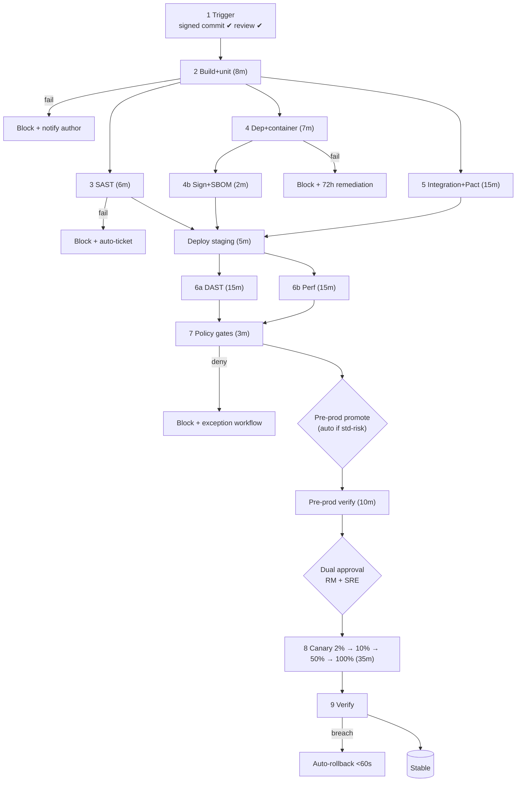

# Deliverable 1 — Pipeline Architecture

> **AI Attribution:** Drafted with Claude (Anthropic) on 23 Oct 2026 as an AI-accelerated first draft. Reviewed, edited, validated (linters, unit tests, source checks) and approved by **Mohammad Sinan Ali**.

## 1. Design principles
1. **Same artefact, different config** — one image (tag `1.14.2+a1b2c3d.20261019T0930Z.run4812` and `sha-a1b2c3d`) is promoted through all four environments. Never `latest`.
2. **Gates are blocking by default**; exceptions are time-boxed, approved by a named role and written to the audit log.
3. **Fail fast, run wide**: cheap checks first, independent checks in parallel.
4. **Hotfix = expedited, not bypassed**: same stages, only the pre-prod soak and CAB step are replaced by an emergency-change approval.
5. **GitOps for deployment, pipeline for proof**: CI produces signed, attested artefacts; ArgoCD reconciles what is in Git.

## 2. Stages
Brief requires 8 canonical stages; this design adds explicit **4b Sign/attest** and **9 Verify** so that provenance and post-deploy verification are auditable controls in their own right → **10 stages**.

| # | Stage | Tool (version) | Blocking threshold | SLA | Runs |
|---|---|---|---|---|---|
| 1 | Source control & trigger | GitHub Enterprise, branch protection, SSH/GPG signed commits | unsigned commit, <1 approval (2 for `/payments/**`), direct push → block | 2 min | serial |
| 2 | Build & unit test | Gradle 8 + JDK 21, Docker BuildKit, JaCoCo | any test fail; line <80% / branch <70%; lockfile drift | 8 min | serial |
| 3 | SAST | SonarQube 10.x + custom banking profile (PII, crypto, SQLi) | 0 Critical/Blocker, ≤2 High, new-code debt ratio ≤5% | 6 min | ∥ |
| 4 | Dependency & container scan | Trivy 0.5x, Syft (CycloneDX), ScanCode/FOSSA | 0 Critical; High with CVSS ≥8.0 (and fix available); GPL/AGPL/SSPL; unapproved base image | 7 min | ∥ |
| 4b | Sign & attest | Cosign (keyless/OIDC), in-toto/SLSA provenance | signature or SBOM attestation missing | 2 min | after 4 |
| 5 | Integration & contract | Testcontainers, Pact broker `can-i-deploy`, ephemeral namespace | any fail; p99 regression >10% vs baseline | 15 min | ∥ |
| 6 | DAST + perf (staging) | OWASP ZAP (API scan from OpenAPI, authenticated), k6 | 0 Critical/High (OWASP Top 10); p99 <500 ms @2× load | 15 min | ∥ (ZAP ∥ k6) |
| 7 | Policy & compliance gates | OPA/Conftest, Kyverno, Checkov, SoD check | any policy deny | 3 min | serial |
| 8 | Deploy (progressive) | Argo Rollouts + Istio; Helm; ArgoCD | analysis fail → abort | 35 min (std) | serial |
| 9 | Verify | smoke suite, synthetic txns, Prometheus analysis | success criteria not met → rollback | in 8 | with 8 |

*Editable source: [`diagrams/01-pipeline-architecture.drawio`](diagrams/01-pipeline-architecture.drawio) (open in diagrams.net) · Graphviz source in `diagrams/src/`. Every stage box carries inputs/outputs, tool, blocking threshold and estimated duration; red dashed edges are failure paths; `∥` marks parallel jobs. All 8 diagrams (blue-green, canary, gates, expand-contract, rollback, promotion, observability) live in [`diagrams/`](diagrams/).*

## 3. Timing budget & commit-to-production
Critical path (minutes, cumulative):

| Step | Duration | Cumulative |
|---|---|---|
| Trigger + checks | 2 | 2 |
| Build + unit | 8 | 10 |
| **Parallel**: SAST 6 / dep+sign 9 / integration 15 → longest | 15 | 25 |
| Deploy to staging | 5 | 30 |
| **Parallel**: DAST 15 ∥ perf 15 | 15 | 45 |
| Policy gates | 3 | 48 |
| Pre-prod deploy + verify (approval request raised at t=25, overlaps DAST) | 12 | 60 |
| Dual approval (SLA 10 min; pre-queued) | 5 residual | 65 |
| Prod canary 2% (10) → 10% (10) → 50% (15) | 35 | 100 |
| 100% shift + verification | 5 | **≈105 min** |

**Result: ≈1 h 45 min commit → 100% production (<2 h target)**, with ≈15 min contingency. The 24 h "bake" runs *after* the change is fully live and does not hold the pipeline; auto-rollback stays armed during it.

### Reconciling the brief's canary table
The brief's 15/30/60-min canary + 24 h bake (≥105 min of canary alone) would breach 2 h. We therefore define two profiles:

| Profile | Applies to | Canary | Total commit→100% |
|---|---|---|---|
| **Standard (default)** | no DB contract, no payments-core change | 2% 10 m → 10% 10 m → 50% 15 m | ≈105 min |
| **High-risk** | contract migrations, payments-core, crypto, infra | 1% 15 m → 5% 30 m → 25% 60 m → 100% + 24 h bake | 3–4 h (explicitly outside the 2 h SLO; CAB required) |

Statistical sufficiency for the accelerated profile: at ≥2,000 TPS, 2% = 40 TPS → 24,000 requests per 10 min, enough for a chi-squared test to detect an error-rate move from 0.05% to 0.15% at 95% confidence. If traffic is below that (night), the analysis **extends** rather than promotes on thin data.

### Lead-time measurement
DORA lead time = commit timestamp → first production exposure (canary start ≈ t+65 min); we additionally publish **commit → 100%** (≈105 min) as the stricter NovaPay SLO.

## 4. Parallelisation (Velocity Audit)
12 jobs: build, sast, deps, sign, integration, dast, perf, policy, deploy-stg, deploy-pre, canary, verify. Jobs that run concurrently with at least one other: sast, deps, sign\*, integration, dast, perf, verify (with canary) = 7/12 ≈ **58% parallel** (>50%). Developer feedback loop (stages 1–5 on a PR): **≈15 min worst-case, ≈9 min with Gradle/Docker cache** → target <10 min p50. Automation: all 10 stages automatic; only dual-approval and (high-risk) CAB are manual → **≈97% of steps automated**. Rollback execution: **<2 min** (Istio weight flip + Rollout abort).

## 5. Failure paths
Every stage emits a `stage_result` event (see docs/03 audit schema). Failure behaviour: auto-ticket + Slack to author; retry only for infra flakes (max 1, never for security gates); *skip* is never allowed for stages 3, 4, 4b, 6, 7. Flaky-test quarantine requires a ticket and expires in 7 days.

## 6. Branching, hotfix, versioning
Trunk-based; branches <24 h; PR + signed commits + CODEOWNERS; monorepo path filters (`services/<svc>/**`) trigger only affected pipelines. **Hotfix path:** `hotfix/*` runs stages 1–7 in full, skips pre-prod soak, requires Emergency Change approval (RM + SRE Lead, retroactive CAB within 24 h), forces canary profile *High-risk-lite* (1% → 10% → 100%, 5 min each). It can never bypass staging — see incident simulation for what happens when it does.

SemVer `MAJOR.MINOR.PATCH+<gitsha>.<UTC timestamp>.run<id>`; images tagged SemVer + `sha-<gitsha>`; Kyverno rejects `:latest` and unsigned images.

## 7. Reusable workflows (10+ services)
Services call `pipeline/.github/workflows/reusable-*.yml` with per-service inputs (`sonar_project_key`, `min_line_cov`, `openapi_path`). See `pipeline/.github/workflows/ci-pipeline.yml`.

## 8. Cross-references
Deploy stage → [Deliverable 2](../02-deployment-strategies/deployment-strategies.md) · Gates → [Deliverable 3](../03-compliance-gates/compliance-gates.md) · DB step → [Deliverable 4](../04-database-migration/database-migration.md) · Promotion → [Deliverable 5](../05-environment-promotion/environment-promotion.md) · Rollback → [Deliverable 6](../06-rollback-specification/rollback-specification.md) · Metrics → [Deliverable 8](../08-observability/observability.md)
