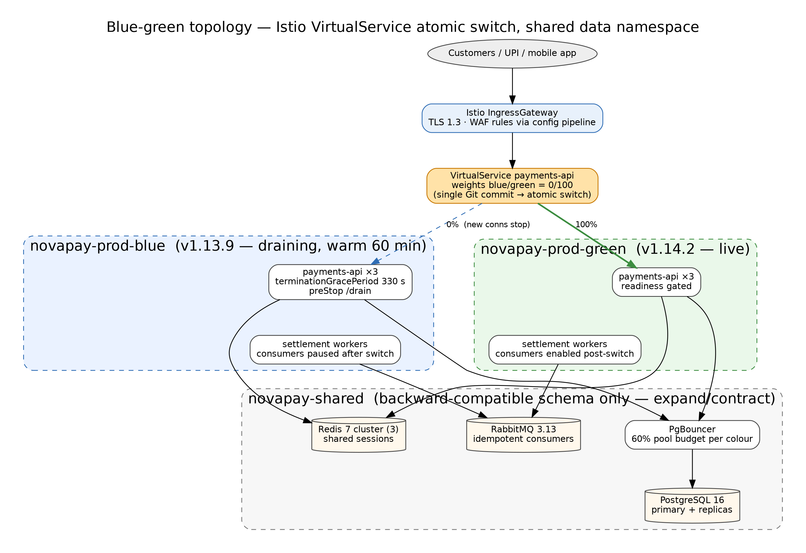
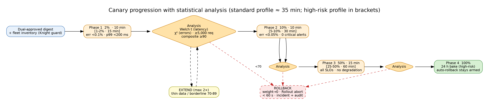

# Deliverable 2 — Blue-Green & Canary Deployment

> **AI Attribution:** Drafted with Claude (Anthropic) on 23 Oct 2026 as an AI-accelerated first draft. Reviewed, edited, validated (linters, unit tests, source checks) and approved by **Mohammad Sinan Ali**.

Pipeline stage reference: [Stage 8–9](../01-pipeline-architecture/architecture.md). Rollback triggers: [Deliverable 6](../06-rollback-specification/rollback-specification.md).

## 1. When to use which
| | Blue-green | Canary |
|---|---|---|
| Use for | breaking infra/runtime changes, major dependency or JVM upgrades, anything needing instant atomic cut-over | all routine service changes (default) |
| Risk exposure | 0% → 100% after pre-switch verification on idle colour | 2% → 10% → 50% → 100% |
| Rollback | flip VirtualService back (<30 s) | abort Rollout, weight → 0 (<60 s) |
| Cost | 2× capacity during switch | ~1.1–1.5× |


*(source: [drawio](../01-pipeline-architecture/diagrams/02-bluegreen-topology.drawio))*

## 2. Blue-green topology
- Namespaces `novapay-prod-blue`, `novapay-prod-green`; shared data namespace `novapay-shared` (PgBouncer → PostgreSQL 16, Redis 7 cluster, RabbitMQ 3.13). Both colours use the **same** database → every schema change must be backward compatible ([Deliverable 4](../04-database-migration/database-migration.md)).
- Istio `VirtualService` holds weights 100/0 for the live colour; the switch is a single atomic manifest update committed to Git (ArgoCD applies it).
- **Sessions:** stateless JWT + Redis-backed session store shared by both colours → no session loss.
- **Messaging:** RabbitMQ consumers on idle colour start with `prefetch=0`/paused; consumers are enabled only after traffic switch; in-flight messages are acked or requeued — handlers are idempotent (idempotency key per payment).

### 5-step switch protocol
1. **Deploy** new version to idle colour (e.g. green); wait Ready; run smoke + synthetic tests through a header-routed test route (`x-novapay-canary: green`).
2. **Pre-flight**: Kyverno/OPA pass, DB schema version compatible, error budget >50%, not in blackout.
3. **Switch**: commit VirtualService 0/100 (blue/green). Istio propagates in seconds. Blue stops receiving *new* connections.
4. **Drain**: blue keeps in-flight requests — HTTP 60 s, payment-settlement jobs up to 5 min (`terminationGracePeriodSeconds: 330`, preStop sleep + `/drain` endpoint, Istio `EXIT_ON_ZERO_ACTIVE_CONNECTIONS`).
5. **Verify & hold**: Prometheus analysis for 15 min; blue stays warm for 60 min (rollback = flip back), then scaled to 0 (not deleted) until the next release.

Long-running transactions: payment jobs carry a `release_id`; a job started on blue completes on blue. The switch step refuses to scale blue down while `payments_inflight{release=blue} > 0`.

```yaml
# pipeline/helm/novapay/templates/virtualservice-bluegreen.yaml (rendered example)
apiVersion: networking.istio.io/v1beta1
kind: VirtualService
metadata: { name: payments-api, namespace: novapay-shared }
spec:
  hosts: [payments.novapay.example]
  gateways: [novapay-gateway]
  http:
    - route:
        - destination: { host: payments-api.novapay-prod-blue.svc.cluster.local, port: { number: 8080 } }
          weight: 0
        - destination: { host: payments-api.novapay-prod-green.svc.cluster.local, port: { number: 8080 } }
          weight: 100
      timeout: 10s
      retries: { attempts: 2, perTryTimeout: 3s, retryOn: connect-failure,refused-stream }
```



## 3. Canary design (Argo Rollouts + Istio)
Standard profile (≈35 min, supports <2 h commit→prod) and High-risk profile (brief's 4-phase table):

| Phase | Std traffic / dwell | High-risk traffic / dwell | Success criteria | Action |
|---|---|---|---|---|
| 1 Canary | 2% / 10 min | 1–2% / 15 min | error rate <0.1%, p99 <200 ms, 0 critical alerts | proceed or auto-rollback |
| 2 Early adopter | 10% / 10 min | 5–10% / 30 min | error rate <0.05%, no new Sev alerts, stat-test pass | proceed or auto-rollback |
| 3 Expansion | 50% / 15 min | 25–50% / 60 min | all SLOs met, no degradation vs baseline | proceed |
| 4 Full | 100% | 100% + **24 h bake** | SLO compliance | mark stable (auto-rollback still armed) |

### Statistical analysis per phase
Baseline = stable ReplicaSet measured **in the same window** (controls for time-of-day) *and* rolling 7-day same-hour production baseline.
- **Latency:** Welch's t-test (unequal variances) on per-minute p50/p95 samples, plus a hard cap on p99. Fail if canary mean is higher with p<0.05 **and** effect >10%.
- **Error rate:** chi-squared test on 2×2 (errors/non-errors × canary/baseline); fail if canary rate is higher with p<0.05 and absolute diff >0.05 pp.
- **Resource:** CPU/memory per pod ≤ 1.2× baseline.
- **Composite score** = 0.4·latency + 0.4·errors + 0.2·resource (each 0–100 from test outcome); promote ≥90, hold/extend 70–89, rollback <70. **Minimum sample guard:** ≥5,000 requests in canary per phase or the phase extends (max 2×) — never promote on thin data.
- Confidence: 95% for automated promotion.

Reference implementation: `pipeline/scripts/canary-analysis.py` (scipy). Argo Rollouts calls it as a `job` metric alongside native Prometheus metrics.

```yaml
# pipeline/helm/novapay/templates/rollout.yaml (excerpt)
strategy:
  canary:
    trafficRouting: { istio: { virtualService: { name: payments-api, routes: [primary] } } }
    steps:
      - setWeight: 2
      - analysis: { templates: [{ templateName: novapay-canary-analysis }], args: [{ name: phase, value: canary }] }
      - pause: { duration: 10m }
      - setWeight: 10
      - analysis: { templates: [{ templateName: novapay-canary-analysis }] }
      - pause: { duration: 10m }
      - setWeight: 50
      - analysis: { templates: [{ templateName: novapay-canary-analysis }] }
      - pause: { duration: 15m }
      - setWeight: 100
```

## 4. Session, connection, config details
- **Connection draining** values above; PgBouncer `server_lifetime`/`reserve_pool` sized so two colours never exceed `max_connections` (pool budget: 60% per colour at peak, enforced by Terraform variable + Checkov rule).
- **Feature flags** decouple deploy from release: risky behaviour ships dark, ramps 1→10→50→100% mirroring canary.
- **Blackout/traffic awareness:** CD workflow calls `blackout-check.sh` ([Deliverable 5](../05-environment-promotion/blackout-calendar.md)); peak hours (10–12, 17–20 IST) allow only hotfix canaries.

## 5. Knight Capital fleet verification
Required by Part C Case Study 1 — see [knight-capital-verification.md](knight-capital-verification.md).

## 6. Lab validation plan (free, laptop or Codespaces)
This design is verified at the policy/rule/script level (see `evidence/test-results/`). To prove the traffic behaviour end-to-end — a step I list honestly as **not yet executed** — use a throw-away cluster:
1. `kind create cluster` → install Istio (`istioctl install --set profile=demo`) and Argo Rollouts (`kubectl apply -n argo-rollouts -f install.yaml`) and Prometheus (kube-prometheus-stack).
2. `helm install novapay pipeline/helm/novapay -f pipeline/helm/novapay/values-staging.yaml` with a sample HTTP app image (digest-pinned).
3. Release a "bad" version that returns 12 % HTTP 500 → expect the AnalysisRun to fail and the Rollout to abort within one analysis interval; capture `kubectl argo rollouts get rollout` output.
4. Run `ALLOW_MIXED=true pipeline/scripts/verify-fleet-version.sh` during the canary and again at 100 % → expect pass; delete one pod's new image to simulate Knight Capital → expect kill-switch.
5. Save the terminal output and Grafana screenshots in `evidence/screenshots/` (names `10-…`).
