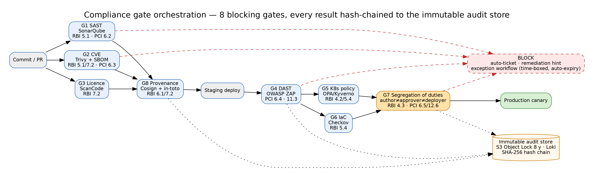
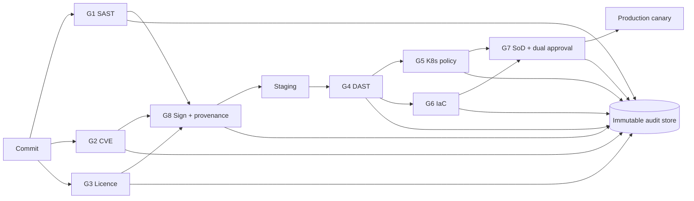

# Deliverable 3 — Automated Compliance Gates

> **AI Attribution:** Drafted with Claude (Anthropic) on 23 Oct 2026 as an AI-accelerated first draft. Reviewed, edited, validated (linters, unit tests, source checks) and approved by **Mohammad Sinan Ali**.

Pipeline reference: [Stage 7](../01-pipeline-architecture/architecture.md). Policies: `pipeline/policies/`.

> **Citation note:** RBI section numbers below follow the project brief (§A.4.1). The 2023 RBI Master Direction on IT Governance, Risk, Controls and Assurance Practices is organised by chapter/paragraph — verify the exact paragraph numbers on rbi.org.in before the TRC. PCI-DSS references use the **corrected** v4.0 numbering (see ERRATA).

## 1. Gate catalogue (8 gates)
| # | Gate | Tool | Pass threshold (numeric) | On failure | Exception (time-bound) | Regulatory mapping |
|---|---|---|---|---|---|---|
| G1 | SAST | SonarQube | 0 Blocker/Critical; ≤2 High; line ≥80%, branch ≥70%; new-code debt ≤5% | Block, auto-ticket, PR comment | CISO, ≤24 h, auto-expires 14 d | RBI 5.1; PCI 6.2 |
| G2 | Dependency / CVE | Trivy | 0 Critical; High blocked if CVSS ≥8.0 & fix exists; SBOM present | Block | 72 h remediation window; Sec-lead approval; auto-expires 72 h | RBI 5.1, 7.2; PCI 6.3 |
| G3 | Licence | ScanCode/FOSSA | 0 GPL/AGPL/SSPL; LGPL → review | Legal review triggered, block | Legal sign-off, ≤30 d | RBI 7.2 |
| G4 | DAST | OWASP ZAP | 0 Critical/High (OWASP Top 10); Medium ≤5 | Block | Risk-acceptance form + TRC, ≤30 d | RBI 5.1; PCI 6.4, **11.3** |
| G5 | Policy (K8s) | OPA/Kyverno | 100% policies pass: no privileged, limits set, non-root, signed image, no `latest`, TLS only | Admission reject | Dual approval (CISO + SRE Lead), ≤7 d | RBI 4.2, 5.4; PCI 2.2, 6.4 |
| G6 | Infra-as-code | Checkov + Conftest | 0 High; no public buckets/0.0.0.0/0; encryption at rest on | PR blocked | Tech Lead exemption, ≤14 d | RBI 5.4; PCI 1.x/3.x |
| G7 | Segregation of duties | pipeline script + GitHub API | author ≠ approver ≠ prod deployer; 2 distinct approvers (RM + SRE Lead); deploy identity ≠ commit identity | Block deploy | **None** (hard control); break-glass logged & reviewed ≤24 h | RBI 4.3; PCI 6.5 |
| G8 | Provenance | Cosign + in-toto | image signed, SBOM + provenance attestation verify against org identity | Admission reject | None | RBI 6.1, 7.2; PCI 6.3 |

Additional (not pipeline-blocking, tracked): **PCI 11.4 penetration test** on a schedule (annual + after significant change) by an independent tester; **PCI 12.6 / security training** verification (deployer must have current training flag in IdP, checked in G7).

## 2. Thresholds per severity
| Severity | SAST | CVE (CVSS) | DAST |
|---|---|---|---|
| Critical | 0 | 0 (≥9.0) | 0 |
| High | ≤2 | 0 if ≥8.0 with fix, else ≤3 | 0 |
| Medium | ≤20 new | informational (30 d SLA) | ≤5 |
| Low | no gate | no gate | no gate |

## 3. Remediation guidance (surfaced in PR comment)
- **SAST High/Critical:** link to rule + secure-coding snippet; autofix suggestion where available; owner = PR author; SLA 24 h.
- **CVE:** show fixed version and dependency path (`gradle dependencyInsight`); Renovate PR auto-raised; SLA Critical 72 h.
- **Licence:** propose permissive alternative from approved list.
- **DAST:** request/response evidence + OWASP cheat-sheet link.
- **Policy:** exact failing field and corrected YAML fragment.

## 4. Exception workflow
1. Requestor files `exception` issue form: gate, finding IDs, business justification, compensating control, requested expiry.
2. Approver per table (never the author). Approval recorded as signed GitHub review.
3. Pipeline reads `exceptions/active.json` (in a protected repo); each entry has `expires_at`. **Expiry is enforced by the pipeline** — expired = gate blocks again. Max duration per gate above.
4. Weekly report of active exceptions to Head of Compliance; >3 active per service triggers TRC review.

## 5. Structured audit record (JSON Schema)
```json
{
  "$schema": "https://json-schema.org/draft/2020-12/schema",
  "title": "NovaPayGateResult",
  "type": "object",
  "required": ["event_id","timestamp","pipeline_run_id","service","git_sha","image_digest","gate","result","thresholds","findings_summary","actor","controls"],
  "properties": {
    "event_id": {"type":"string","format":"uuid"},
    "timestamp": {"type":"string","format":"date-time"},
    "pipeline_run_id": {"type":"string"},
    "service": {"type":"string"},
    "git_sha": {"type":"string","pattern":"^[0-9a-f]{40}$"},
    "image_digest": {"type":"string","pattern":"^sha256:[0-9a-f]{64}$"},
    "gate": {"enum":["G1-SAST","G2-DEP","G3-LIC","G4-DAST","G5-POLICY","G6-IAC","G7-SOD","G8-PROV"]},
    "result": {"enum":["PASS","FAIL","EXCEPTION"]},
    "thresholds": {"type":"object"},
    "findings_summary": {"type":"object","properties":{"critical":{"type":"integer"},"high":{"type":"integer"},"medium":{"type":"integer"}}},
    "exception": {"type":"object","properties":{"id":{"type":"string"},"approver":{"type":"string"},"expires_at":{"type":"string","format":"date-time"}}},
    "actor": {"type":"object","properties":{"author":{"type":"string"},"approvers":{"type":"array","items":{"type":"string"}},"deployer":{"type":"string"}}},
    "controls": {"type":"array","items":{"type":"string"},"description":"e.g. RBI-4.2, PCI-6.2"},
    "evidence_uri": {"type":"string","format":"uri"},
    "prev_hash": {"type":"string"}, "hash": {"type":"string"}
  }
}
```
**Immutability:** records are hash-chained (`hash = SHA-256(record ‖ prev_hash)`) and written to S3 Object Lock (compliance mode, 8-year retention) and Loki; the Regulatory dashboard reads from that store. This satisfies RBI 6.1 / PCI 10.2 audit-trail intent.



## 6. Gate orchestration


## 7. RBI / PCI coverage matrix
| Requirement | Gate(s) / control | Evidence |
|---|---|---|
| RBI 4.2 change mgmt | G5, G7, dual approval, auto-rollback | audit record + Argo history |
| RBI 4.3 SoD | G7 | actor fields |
| RBI 5.1 vuln assessment | G1, G2, G4 | scan reports |
| RBI 5.4 encryption | G5/G6 (TLS 1.3, at-rest) | policy results |
| RBI 6.1 audit trails | audit store | hash chain |
| RBI 6.3 incident/BCP | rollback + runbook + DR drill | [D6](../06-rollback-specification/rollback-specification.md), [D7](../07-runbook-playbook/incident-simulation.md) |
| RBI 7.2 third-party | G2, G3, SBOM | CycloneDX |
| PCI 6.2 / 6.3 / 6.4 / 6.5 | G1 / G2 / G4+WAF / G7 | – |
| PCI 10.2 | audit store | – |
| PCI **11.3** (vuln scans) | G2, G4 | ASV/internal scan reports |
| PCI **11.4** (pen test) | scheduled external test | report in evidence/ |
| PCI 12.6 | training flag in G7 | IdP export |

Sample Rego policies: `pipeline/policies/*.rego` (5 files) and Kyverno `verify-images.yaml`.
