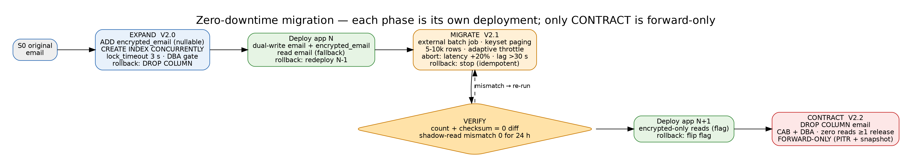

# Deliverable 4 — Zero-Downtime Database Migration (Expand → Migrate → Contract)

> **AI Attribution:** Drafted with Claude (Anthropic) on 23 Oct 2026 as an AI-accelerated first draft. Reviewed, edited, validated (linters, unit tests, source checks) and approved by **Mohammad Sinan Ali**.

Applies to PostgreSQL 16 behind PgBouncer. **Tooling correction (ERRATA #3):** gh-ost is MySQL-only and triggerless; for PostgreSQL use **pgroll** (versioned schemas, automatic dual-write views) or hand-rolled expand-contract with Flyway.

## 1. Principles
- Each phase is its **own deployment**, independently reversible except Contract.
- Schema changes never take long `ACCESS EXCLUSIVE` locks: `lock_timeout=3s`, `statement_timeout` set, retry with backoff; `CREATE INDEX CONCURRENTLY`; `ADD CONSTRAINT … NOT VALID` then `VALIDATE CONSTRAINT`; nullable column adds with no volatile default (PG11+ makes constant defaults metadata-only).
- App N−1 and N must both work at every schema state.
- DBA approval gate before Expand and a separate CAB-level approval before Contract.



## 2. Worked example (matches Appendix reference): encrypt `customer_profiles.email`
| Phase | Release | Schema action | App behaviour | Rollback |
|---|---|---|---|---|
| **EXPAND** V2.0 | DB first, app unchanged | add `encrypted_email BYTEA` (nullable); index built concurrently | N−1 ignores column | `DROP COLUMN` (safe: nothing reads it) |
| deploy app N | N | – | **dual-write**: writes `email` + `encrypted_email`; reads `email` (fallback) | roll back app; column harmless |
| **MIGRATE** V2.1 | batch job | backfill all rows in batches | N reads `encrypted_email` if present else `email` | stop job; idempotent – resume |
| verify | – | row-count + checksum reconciliation; shadow-read mismatch rate = 0 for 24 h | N reads encrypted only | revert read flag |
| deploy app N+1 | N+1 | – | stops using `email` entirely (flag-gated) | flag back to N behaviour |
| **CONTRACT** V2.2 | separate release, CAB + DBA | `ALTER TABLE … DROP COLUMN email` after ≥1 full release cycle with zero reads (confirmed via `pg_stat_statements`/query logs) | N+1 only | **forward-only** – restore from PITR + pre-contract logical snapshot of the column |

## 3. Version compatibility matrix
| Schema state | App N−1 (reads/writes `email`) | App N (dual-write) | App N+1 (encrypted only) |
|---|---|---|---|
| S0 original | ✅ | ✅ (will fail writes to missing column → **deploy only after S1**) ❌ before S1 | ❌ |
| S1 after EXPAND | ✅ | ✅ | ⚠️ ✅ only after backfill verified |
| S2 after MIGRATE (backfill complete, dual-write on) | ✅ | ✅ | ✅ |
| S3 after CONTRACT (`email` dropped) | ❌ **must be fully retired** | ❌ | ✅ |
Rule enforced in CI (Stage 5): the pipeline applies the *next* migration to a snapshot and runs the contract tests of both app versions listed as "✅"; the Contract migration is blocked unless Pact broker shows **zero** deployed consumers of version <N+1.

## 4. Backfill strategy for 100M+ rows
- **External batch job** (Kubernetes CronJob / `scripts/backfill_encrypted_email.py`) — *not* a single `DO` block (one transaction, no commits between batches).
- Keyset pagination on PK: `WHERE id > :last AND id <= :last + :batch AND encrypted_email IS NULL` (index-friendly; no OFFSET, no `LIMIT FOR UPDATE` without order).
- **Batch size** 5,000–10,000 rows (target <200 ms per batch); **throttle** adaptive: sleep = max(100 ms, 2 × last batch duration); pause if replica lag >5 s, p95 query latency >+20% vs baseline, or `pg_stat_activity` waiting locks >0.
- Encrypt **client-side** with a KMS-wrapped data key (no key in a GUC / SQL text / logs).
- Estimate: 100M / 10k = 10,000 batches × (~0.25 s work + 0.5 s sleep) ≈ 2 h; run off-peak, outside blackout.
- Idempotent (`encrypted_email IS NULL` predicate) and resumable (checkpoint table). Emits metrics: rows/s, lag, remaining.
- **Abort criteria (auto):** latency impact >20%, replication lag >30 s, error rate >0.5%, disk/WAL alarm. Alert DBA; job stops cleanly.
- WAL/bloat: vacuum tuning (`autovacuum_vacuum_scale_factor` lowered on table during job), monitor `pg_wal` growth.

## 5. Governance framework
1. **Design review** – PR template with: lock analysis (`pg_locks` expectation), estimated duration on prod-size data, rollback per phase, compatibility matrix row.
2. **DBA gate** – CODEOWNERS `/db/**` requires DBA approval; checklist: lock_timeout set, concurrently used, no table rewrite (`ALTER … TYPE` banned without pgroll), idempotent, audited.
3. **Pre-prod rehearsal** on masked production-scale data (required to promote to prod; see D5).
4. **Audit** – every migration inserts into `schema_audit_log` (phase, executor, checksum); Flyway `schema_history` shipped to immutable store (RBI 6.1).
5. **ACID/banking constraints** – no phase may leave a financial table with partial invariants visible to readers; balances/ledger tables are never rewritten, only appended/expanded; reconciliation query must be zero-diff before moving phases.

## 6. Tool selection
| Need | Tool |
|---|---|
| Versioned migrations | Flyway 10 (`executeInTransaction=false` for concurrent index scripts) |
| Online column/type/constraint change on big tables | **pgroll** (creates new-version view schema, dual-write triggers, instant rollback until `complete`) |
| Bulk backfill | custom Python job (above) or pgroll backfill |
| Bloat reclaim | pg_repack (if needed) |
```json
{ "name": "02_encrypt_email", "operations": [ { "add_column": { "table": "customer_profiles", "column": { "name": "encrypted_email", "type": "bytea", "nullable": true }, "up": "NULL" } } ] }
```
(pgroll example; `pgroll start` → dual versions → `pgroll complete` / `pgroll rollback`.)

## 7. Rollback per phase
Expand → drop column · App N → redeploy N−1 · Migrate → stop; data is additive · Switch-read → flip flag · Contract → PITR/restore (practice quarterly; RTO ≤30 min for the affected table).

Runnable examples: `examples/V2.0__expand_add_encrypted_email.sql`, `examples/V2.0__expand_add_encrypted_email.sql.conf`, `examples/backfill_encrypted_email.py`, `examples/V2.2__contract_drop_email.sql`.
