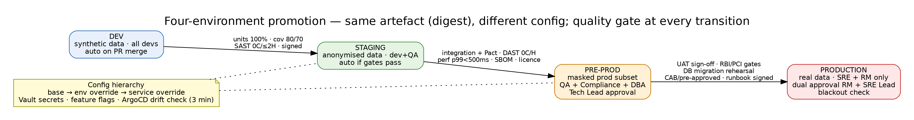

# Deliverable 5 — Environment Promotion Workflow

> **AI Attribution:** Drafted with Claude (Anthropic) on 23 Oct 2026 as an AI-accelerated first draft. Reviewed, edited, validated (linters, unit tests, source checks) and approved by **Mohammad Sinan Ali**.

Principle: **same artefact, different config.** The signed image digest produced in Stage 4b is the only thing promoted; environments differ only in Helm values, secrets and data.

## 1. Environment model
| Env | Purpose | Data profile | Access | Deploy trigger | Cluster/account |
|---|---|---|---|---|---|
| dev | feature dev, unit/integration | synthetic only | all developers | auto on PR merge | shared non-prod |
| staging | integration, DAST, perf | anonymised prod-like (k-anonymity, tokenised PAN/Aadhaar) | dev + QA | auto after dev gates pass | non-prod |
| pre-prod | UAT, compliance verification, migration rehearsal | masked subset of prod, production-scale | QA + Compliance + DBA | **manual approval** (Tech Lead) — auto for std-risk pre-approved changes | prod-like, isolated |
| production | live | real | SRE + Release Manager only (JIT access, 4 h expiry) | **dual approval** RM + SRE Lead | prod account, separate IdP group |

## 2. Promotion criteria
**dev → staging (automatic):** unit tests 100% pass; line ≥80% / branch ≥70%; SAST 0 Critical, ≤2 High; image signed + SBOM attached; SemVer tag present.

**staging → pre-prod (Tech Lead approval, auto if change class = pre-approved):** all integration + Pact `can-i-deploy`; DAST 0 Critical/High; p99 <500 ms @2× load; 0 Critical CVE + SBOM archived; licence check pass; migration applied cleanly on staging snapshot.

**pre-prod → production (dual approval):** UAT sign-off by Product Owner (signed GitHub review); RBI/PCI gate matrix all green (G1–G8); migration rehearsed on masked production-scale data with recorded timings; runbook reviewed by SRE Lead; **CAB approval OR pre-approved change category** (std-risk: no schema contract, no payments-core change, passed error budget check); dual approval RM **and** SRE Lead (≠ author, ≠ each other); blackout/peak check passes; on-call engineer acknowledged in PagerDuty.

## 3. Approval workflow & RBAC
| Role | Can | Cannot |
|---|---|---|
| Developer | merge PR (with review), deploy to dev | approve own PR, touch prod, see prod secrets |
| QA | approve UAT, promote staging→pre-prod w/ Tech Lead | deploy prod |
| Tech Lead | approve staging→pre-prod | approve prod |
| DBA | approve migrations | deploy app |
| Release Manager | first prod approver, triggers deploy | be author or SRE approver |
| SRE Lead | second prod approver, rollback authority | be author |
| CISO | exceptions for SAST/policy | – |
Implemented via GitHub Environments (required reviewers, "prevent self-review", wait timer), separate prod OIDC role for the deploy job, and G7 verification in the pipeline.

## 4. Configuration management
Hierarchy: `values.yaml` (base) → `values-<env>.yaml` → per-service overrides (`services/<svc>/values-<env>.yaml`). Files in `pipeline/helm/novapay/`.
- **Secrets:** HashiCorp Vault (K8s auth) via External Secrets Operator; DB passwords rotate 90 d, API keys 30 d; no plaintext in Git/Helm/manifests (Gitleaks in Stage 1 + Conftest rule).
- **Feature flags:** OpenFeature/LaunchDarkly-style; prod default **off**; ramp 1→10→50→100% mirrors canary; flag changes go through PR + audit like code (Cloudflare lesson).
- **Drift detection:** ArgoCD compares Git vs live every 3 min; drift → Slack + (staging/dev auto-sync, prod **alert-only** with manual sync to keep change control).
- **No env branches:** one `main`; difference only in values.
- **Prod ArgoCD source:** pinned to a tag/commit written by the approved deploy job (not `HEAD`).

## 5. Data management
| Env | Technique |
|---|---|
| dev | synthetic generator (Faker, seeded) |
| staging | anonymisation: irreversible hashing/generalisation, tokenised identifiers, no PAN, referential integrity preserved |
| pre-prod | format-preserving masking (FPE) with key in separate Vault; access audited; refreshed weekly, DPDP-Act-aware retention |
| prod | real data; DB access via bastion + JIT + session recording |

Blackout & traffic-aware deployment calendar: [blackout-calendar.md](blackout-calendar.md).
