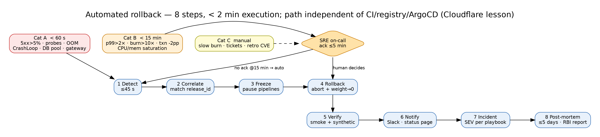

# Deliverable 6 — Automated Rollback Specification

> **AI Attribution:** AI-assisted (Claude, Anthropic); reviewed and validated by Mohammad Sinan Ali.

Observability metrics referenced here are defined in [Deliverable 8](../08-observability/observability.md). Rules: `rollback-alerts.yaml` (this folder).

## 1. Design rules
- Rollback is **faster than debugging**: default response to a breach is revert, investigate later.
- Rollback path is **independent of the deploy path** (Cloudflare lesson): Istio weight flip + Argo Rollouts abort use the cluster control plane directly via a pre-authorised `rollback-bot` ServiceAccount and a break-glass CLI; neither depends on the CI system, registry or ArgoCD being healthy. Previous stable ReplicaSet/colour is kept warm.
- Detection budget fixed so **Category A completes in <60 s end-to-end**: scrape 15 s + rule evaluation 15 s + 30 s window ⇒ detect ≤45 s, action ≤10 s. (The brief's "5xx >5% for 60 s" is tightened to 30 s to make the 60 s SLO achievable — see ERRATA.)

## 2. Category A — Immediate (<60 s, no human)
| # | Trigger | Detection | Threshold | Action |
|---|---|---|---|---|
| A1 | HTTP 5xx rate | Istio `istio_requests_total{response_code=~"5.."}` canary subset | >5% for 30 s | weight→0, abort |
| A2 | Readiness/health failure | kube probes / `kube_pod_status_ready` | 3 consecutive failures (3×5 s) | abort, scale new RS to 0 |
| A3 | OOMKilled | `kube_pod_container_status_last_terminated_reason{reason="OOMKilled"}` | ≥1 new-version pod in 5 min (≥2 = immediate) | abort |
| A4 | CrashLoopBackOff | `kube_pod_container_status_waiting_reason{reason="CrashLoopBackOff"}` | any new-version pod | abort |
| A5 | DB connection-pool exhaustion | `pgbouncer_pools_cl_waiting` / HikariCP `hikaricp_connections_pending` | waiting clients >50 for 20 s | abort + page DBA |
| A6 | Version/hash mismatch (Knight Capital) | `verify-fleet-version.sh` | any mismatch | kill-switch + abort |
| A7 | Payment gateway timeouts | `gateway_timeout_ratio` | >20% for 30 s | abort |

## 3. Category B — Escalated (<15 min; alert on-call, auto-rollback if no human response)
| # | Trigger | Threshold | Alert/escalation |
|---|---|---|---|
| B1 | p99 latency | >2× baseline for 5 min | page SRE on-call (ack in 5 min) → auto-rollback at T+10 min if unacked |
| B2 | Error-budget burn rate | >10× (1 h/5 m multiwindow) for 10 min | page SRE, escalate VP Eng at +10 min |
| B3 | Transaction success rate | >2 pp below baseline | page SRE + Payments lead |
| B4 | Resource saturation | CPU >90% or memory >85% sustained 5 min | page SRE; HPA already at max |
| B5 | Downstream dependency error correlation | dependency 5xx up ≥3× within 10 min of rollout | page owning team |
Escalation timeline: T+0 alert → T+5 min ack required → T+10 min second page (SRE Lead) → T+15 min **auto-rollback** if still unresolved.

## 4. Category C — Manual decision (human judgment)
Slow degradation inside thresholds (e.g., p99 +40% over 2 h), customer-support ticket spikes, retroactive compliance finding (new CVE or policy failure on a running image), correlated downstream degradation. Surfaced as **warnings** in Grafana and a Slack `#release-watch` thread; decision owner = SRE Lead; options: continue / feature-flag off / freeze canary / rollback. Decision logged to the change record.

## 5. 8-step rollback workflow
| Step | Action | Automated by | Target time |
|---|---|---|---|
| 1 Detect | alert fires (Prometheus → Alertmanager → rollback-bot webhook) | Prometheus | ≤45 s |
| 2 Correlate | match alert to active rollout/release_id; skip if no recent change (avoid rolling back unrelated incident) | rollback-bot | ≤5 s |
| 3 Freeze | pause pipelines for the service, lock further promotions | bot | ≤5 s |
| 4 Rollback | canary: `kubectl argo rollouts abort` + weight 0; blue-green: VirtualService to previous colour | bot | ≤20 s |
| 5 Verify | smoke + synthetic payments + compare metrics to pre-release baseline for 5 min | bot | ≤2 min |
| 6 Notify | Slack, status page (if customer-visible), PagerDuty note, change record updated | bot | ≤1 min |
| 7 Incident | open incident (severity per D7) if customer impact; else ticket | bot/human | ≤5 min |
| 8 Postmortem | blameless review within 5 business days; action items tracked; RBI report if >30 min customer impact | human | ≤5 d |
**Rollback execution time: <2 min** (scores full Velocity Audit points).

## 6. Post-rollback verification
- **Smoke tests:** login, balance, fund transfer (sandbox), UPI collect/pay simulator.
- **Metric comparison:** error rate, p99, TPS within ±5% of pre-release 1 h baseline.
- **Customer impact assessment:** failed-transaction count between T0 and rollback, affected cohorts (from logs/traces), reconciliation job triggered for in-flight payments; results go to Compliance for RBI reporting decisions.
- **Data check:** if a migration ran, confirm phase-compatible schema (Expand/Migrate are safe; Contract → no auto-rollback, see D4).

## 7. Alert rules
See `rollback-alerts.yaml` (Prometheus rules, validated YAML) and `pipeline/helm/novapay/templates/analysis-template.yaml`.
