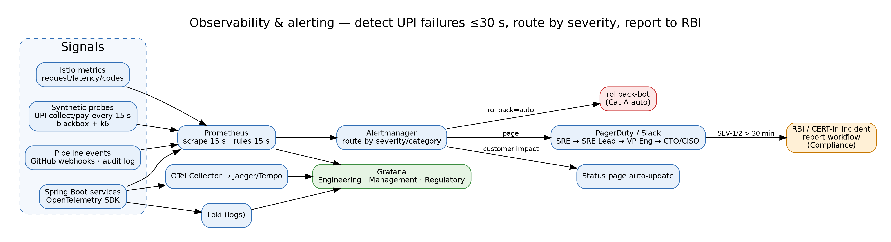

# Deliverable 8 — Observability, DORA & Dashboards

> **AI Attribution:** Drafted with Claude (Anthropic) on 23 Oct 2026 as an AI-accelerated first draft. Reviewed, edited, validated (linters, unit tests, source checks) and approved by **Mohammad Sinan Ali**.

Stack (brief §B2.1): Prometheus + Alertmanager + Grafana, OpenTelemetry → Jaeger/Tempo, Loki, Sloth/Pyrra for SLOs.



## 1. DORA metrics
| Metric | Definition | NovaPay target | Measurement |
|---|---|---|---|
| Deployment frequency | prod deployments/day | multiple/day (≥3 std services) | count of `deploy_finished{env="prod",result="success"}` |
| Lead time for changes | commit → prod | **<1 h to canary start is stretch; SLO commit→100% ≤ 2 h (≈105 min)**; p50 reported | `pipeline_commit_to_prod_seconds` = deploy_ts − first_commit_ts (from Git API + Argo event) |
| Change failure rate | % deploys causing rollback/hotfix/incident | <5% | (rollbacks + hotfixes) / deploys |
| MTTR | detection → restore | **<15 min** (vs 4.5 h today); DORA elite <1 h | incident open→resolved timestamps |
Note: the brief's "<1 h lead time" is the 2018 "elite" bar; 2024 DORA lists <1 day — we keep ≤2 h as the contractual NovaPay SLO.

## 2. Pipeline metrics (18)
| Category | Metric | Target |
|---|---|---|
| Build | build success rate | >95% |
| Build | build duration p50/p95 | <8 / <12 min |
| Build | cache hit rate (Gradle/BuildKit) | >80% |
| Build | flaky test rate; top-10 flaky tests | <1% |
| Build | developer feedback loop (PR → green) | <10 min p50 |
| Compliance | gate pass rate per gate (G1–G8) | tracked; <90% triggers review |
| Compliance | false-positive rate per scanner | <10% |
| Compliance | mean time to remediate Critical CVE | <72 h |
| Compliance | active exceptions count / expired-unclosed | ≤3 per service / 0 |
| Compliance | % releases with complete audit record | 100% |
| Deploy | deployment duration (canary start→100%) | ≤35 min std |
| Deploy | rollback frequency & trigger distribution (A/B/C) | <5%; mostly A/B |
| Deploy | rollback execution time | <2 min |
| Deploy | canary composite score distribution | – |
| Deploy | % deploys inside blackout violated | 0 |
| Reliability | availability SLO (five-nines design) | 99.999% critical payment path |
| Reliability | error-budget burn rate | <1× |
| Reliability | synthetic probe success | >99.9% |
**Five-nines reality check:** 99.999% = 5 min 15 s downtime/year. Achieved via multi-AZ, N+2 capacity, zero-downtime deploys, <60 s auto-rollback, PodDisruptionBudgets and DR drills; it is a *design target* measured on the payment critical path, not a promise from the pipeline alone. A single 5-min incident consumes the whole annual budget — hence canary + auto-rollback.

## 3. SLOs (Sloth-style)
```yaml
version: "prometheus/v1"
service: payments-api
slos:
  - name: availability
    objective: 99.999
    sli: { events: { error_query: sum(rate(istio_requests_total{destination_service_name="payments-api",response_code=~"5.."}[{{.window}}])), total_query: sum(rate(istio_requests_total{destination_service_name="payments-api"}[{{.window}}])) } }
    alerting: { name: PaymentsAvailability, page_alert: { labels: { severity: critical } }, ticket_alert: { labels: { severity: warning } } }
```

## 4. Dashboards (wireframes in `dashboards/mockups/`, JSON in `dashboards/grafana/`)
1. **Engineering (real-time ops):** current rollouts & canary weight, 5xx/p99 by version, pool saturation, queue depth, alerts firing, rollback bot activity.
2. **Management (weekly/monthly):** four DORA metrics trend, deploys/day, change failure rate, MTTR, availability vs SLO, cost per deploy, top blockers.
3. **Regulatory (audit-ready):** gate pass/fail per release, exceptions register with expiry, RBI/PCI control coverage, SoD evidence, immutable-audit hash-chain status, incident log with regulator-notification status.

## 5. Alerting strategy
| Severity | Route | Ack SLA | Escalation |
|---|---|---|---|
| critical (auto-rollback class) | PagerDuty + Slack #inc | 5 min | SRE → SRE Lead (10 min) → VP Eng (15) |
| critical (no rollback) | PagerDuty | 5 min | as above |
| warning | Slack #release-watch | 30 min | ticket |
| info | dashboard only | – | – |
Alertmanager: group by `service,release_id`; inhibit warnings when a critical fires; maintenance silences only via pipeline during approved change (audit-logged). Anomaly detection (Sandbox): seasonality-aware baseline (Prophet/STL) for TPS and latency.

## 6. YES Bank-style detection (Case Study 2): UPI failure visible in ≤30 s
- **Signal:** UPI `txn_total{outcome}` + NPCI-style Technical Decline Rate (TD%) computed every 15 s; synthetic UPI collect/pay probe every 15 s from 3 vantage points.
- **Rule:** `TD% > 2%` (or >2 pp over 1 h baseline) for 30 s → page; scrape 15 s + evaluation 15 s = **≤30 s**. Black-box probe failing 2 consecutive runs (30 s) → page.
- **Escalation:** SEV-1 path (CTO, CISO, VP Eng); auto status-page update via Alertmanager webhook ("Investigating UPI payment failures").
- **Regulatory workflow:** incident timer starts at detection; at **T+30 min** of customer-impacting outage the bot opens a Compliance task with prefilled RBI/NPCI incident template (times, scope, root cause draft); final report tracked to closure. (The 30-minute trigger is the case-study parameter; real obligations are stricter for cyber incidents — CERT-In requires reporting within **6 hours** — and Compliance owns the exact RBI/NPCI thresholds.) Rules are tested: [`observability-rules.yaml`](observability-rules.yaml) + [`observability-rules.test.yaml`](observability-rules.test.yaml).
- **DR:** quarterly automated failover test as a scheduled pipeline (chaos/Litmus) — DR is tested, not just documented.
```yaml
- alert: UPITechnicalDeclineRateHigh
  expr: sum(rate(upi_txn_total{outcome="technical_decline"}[30s])) / sum(rate(upi_txn_total[30s])) > 0.02
  for: 30s
  labels: { severity: critical, regulatory: "true" }
```

## 7. Metric catalogue (names used by the dashboards and rules)
| Metric | Type | Source | Used in |
|---|---|---|---|
| `novapay_deploy_finished_total{env,service,result}` | counter | CD workflow / Argo event exporter | DORA frequency, CFR |
| `novapay_pipeline_commit_to_prod_seconds` | histogram | Git API + Argo event | DORA lead time, SLO alert |
| `novapay_deploy_rollback_total{category,trigger}` | counter | rollback-bot | CFR, trigger distribution |
| `novapay_incident_mttr_seconds` | histogram | incident tooling | MTTR |
| `novapay_gate_result_total{gate,result}` | counter | `emit-audit.sh` | gate pass rate, blockers |
| `novapay_stage_duration_seconds` | histogram | workflow exporter | stage heat-map |
| `novapay_build_total{result}`, `novapay_cache_hit_ratio`, `novapay_flaky_test_ratio`, `novapay_feedback_loop_seconds` | counter / gauge / histogram | CI exporter | build health |
| `novapay_scanner_false_positive_ratio{tool}` | gauge | triage labels | scanner quality |
| `novapay_cve_remediation_seconds{severity}` | histogram | ticketing | 72 h SLA |
| `novapay_exception_active / _expired_open / _expires_timestamp_seconds` | gauge | exceptions store | regulatory register |
| `novapay_audit_chain_valid`, `novapay_release_audit_complete_ratio` | gauge | audit verifier job (hourly) | integrity panels |
| `novapay_blackout_violation_total` | counter | `blackout-check.sh` | compliance |
| `novapay:availability:ratio_30d`, `novapay:error_ratio:*` | recording rules | [`observability-rules.yaml`](observability-rules.yaml) | SLO, burn rate |
Dashboards are **generated from code** (`dashboards/grafana/generate_dashboards.py`) and wireframes are generated from the same JSON (`dashboards/mockups/generate_wireframes.py`), so design and implementation cannot drift.

## 8. Sandbox work
ML anomaly canary, predictive test selection, compliance drift, chaos and DX metrics: [sandbox-extensions.md](sandbox-extensions.md).
