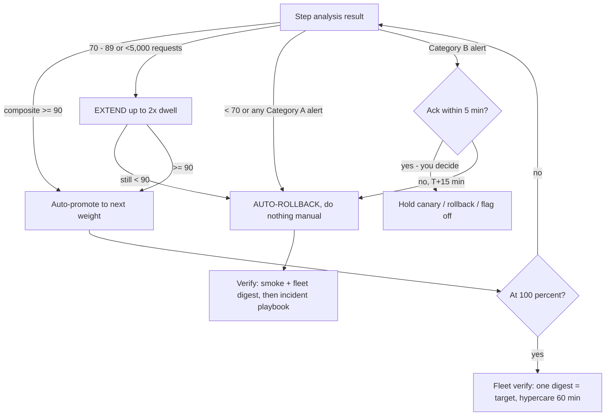

# NovaPay Production Deployment Runbook (3 AM standard)

> **AI Attribution:** AI-assisted (Claude, Anthropic); reviewed and validated by Mohammad Sinan Ali.

**Who:** Release Manager (RM) executes, SRE Lead co-approves, on-call SRE watches. **Goal:** any on-call can run this with no prior context.

## A. Pre-deployment checklist (all 8 must be ✅ — attach evidence link)
| # | Check | Evidence |
|---|---|---|
| 1 | Release ID, SemVer, image digest recorded; image **signed** (`cosign verify` OK) | Cosign output |
| 2 | Gates G1–G8 all PASS (or active, unexpired exceptions listed) | Audit record link |
| 3 | UAT sign-off from Product Owner | signed review |
| 4 | Dual approval: RM **and** SRE Lead (neither is the author) | GitHub Environment approvals |
| 5 | Not in blackout/peak window (`blackout-check.sh` exit 0) | script output |
| 6 | DB migration phase confirmed & rehearsed in pre-prod; compatibility row OK; no Contract unless CAB ticket | change record |
| 7 | Error budget >50% remaining; no open SEV-1/2 | Grafana SLO panel |
| 8 | On-call engineer briefed & ack'd; rollback target (previous version/colour) identified & warm | PagerDuty ack |
**If any ✘ → STOP. Do not proceed. Post in #release-watch.**

## B. Execution
1. Open Grafana **Engineering → Release** dashboard and status page draft.
2. Trigger CD workflow `cd-pipeline` → environment `production` (approvals prompt).
3. **Decision tree at each canary step** (Argo Rollouts UI / `kubectl argo rollouts get rollout payments-api -w`):
   - 2% (10 min): analysis ✅ → auto-promote. ❌ → auto-rollback happens; go to §D.
   - 10% (10 min): same. If `composite < 90` but ≥70 → analysis **extends**; wait up to 2×; still <90 → treat as ❌.
   - 50% (15 min): same; confirm HPA headroom (CPU <70%).
   - 100%: confirm all pods **same image digest** (`verify-fleet-version.sh`).

**Decision tree — each canary step (print this for 3 AM):**

4. Blue-green change: deploy idle colour → header-routed smoke → switch VirtualService → drain 60 s (5 min for settlement) → hold 60 min.
5. If **any Category A** alert fires: do nothing manual — bot rolls back <60 s. Watch, then §D.
6. If Category B alert: ack within 5 min; decide rollback or hold. No response by T+15 = auto-rollback.

## C. Post-deployment verification (expected outcomes)
| Check | Expected |
|---|---|
| Smoke suite (login, balance, ₹1 sandbox transfer, UPI simulator) | all pass |
| Synthetic probes (3 regions) | success ≥99.9% |
| Error rate / p99 | ≤ pre-release baseline +5% |
| DB: replication lag <1 s, pool waiting = 0 | yes |
| Fleet verification | single digest = target |
| Audit record present for release | yes |
Keep **hypercare** for 60 min (std) / 24 h bake (high-risk). Mark change **Successful** in the change record only after bake.

## D. If it goes wrong
Rollback is already running or: `./pipeline/scripts/rollback.sh <service>` (break-glass, independent of CI). Then follow [incident playbook](incident-playbook.md). **Never** "fix forward" during peak hours. Do not drop columns/Contract migrations on rollback — escalate to DBA.

## E. Contacts (escalation order; simulated NovaPay directory)
| Role | Reach via | Ack SLA |
|---|---|---|
| SRE on-call | PagerDuty schedule `novapay-sre-primary` | 5 min |
| SRE Lead | PagerDuty `novapay-sre-lead` (auto-escalates at +10 min) | 10 min |
| DBA on-call | PagerDuty `novapay-dba` (any migration / pool incident) | 10 min |
| VP Engineering | PagerDuty `novapay-vpeng` (+15 min; SEV-1/2) | 15 min |
| CISO / CTO | PagerDuty `novapay-exec` (SEV-1, security or data-integrity risk) | 15 min |
| Head of Compliance | Slack `#compliance-oncall` + phone tree (regulatory notification decisions) | 30 min |
